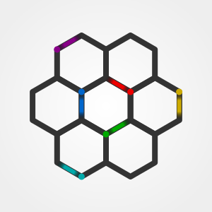

<p align="center"></p>

# PicoActor

AOT互換のインメモリ Actor フレームワーク。Event Sourcing 対応。
軽量・ゼロリフレクション、AI エージェントシステムとワークフロー
オーケストレーション向け。NativeAOT およびトリミング環境で動作。

[](https://github.com/PicoHex/PicoActor/actions/workflows/ci.yml)
[](https://www.nuget.org/packages/PicoActor)
[](LICENSE)

[English](README.md) | [简体中文](README.zh.md) | [日本語](README.ja.md) | [Español](README.es.md) | [Português](README.pt.md) | [繁體中文](README.zh-tw.md) | [한국어](README.ko.md) | [Français](README.fr.md) | [Deutsch](README.de.md) | [Русский](README.ru.md)

---

## 計算モデル

```
┌─────────────────────────────────────────────────┐
│                  ActorSystem                     │
│  ┌─────────┐  ┌─────────┐  ┌─────────┐         │
│  │ Counter │  │  Agent  │  │ Session │  ...     │
│  │ (Actor) │  │ (Actor) │  │ (Actor) │         │
│  └────┬────┘  └────┬────┘  └────┬────┘         │
│       │            │            │               │
│       ▼            ▼            ▼               │
│  ┌─────────────────────────────────────────┐    │
│  │            IEventStore                   │    │
│  │   AppendAsync / LoadAsync               │    │
│  └─────────────────────────────────────────┘    │
└─────────────────────────────────────────────────┘
```

各 Actor は**メールボックス**（インメモリ `Channel<Envelope>`）、**UUID v7**
ID、シングルスレッド消費ループを持ちます。コマンドは `Send`（fire-and-forget）
または `AskAsync`（リクエスト-リプライ）で配信されます。

PicoActor は**メッセージ駆動**です：すべての相互作用はメッセージです。コマンド（`ICommand`）はメールボックス経由で配信される宛先指定メッセージ（1:1、応答は任意）であり、ドメインイベント（`IDomainEvent`）は PicoMediator 経由で公開されるブロードキャストメッセージ（1:N、応答なし）です。イベントもメッセージです——集約をまたぐ協調パターンは単一のループのみ：イベント → サブスクライバー → 翻訳されたコマンド → メールボックス。これ以外にアクターと相互作用する方法はありません。

Event Sourcing Actor は**Persist-then-Mutate**（永続化してから変更）に従います：
`OnMessageAsync → RaiseEvent → IEventStore に永続化 → Mutate 状態`。
状態は永続化成功後にのみ変更されます——インメモリ状態は常にイベントストリームと一致します。

---

## なぜ PicoActor か

| 観点 | 既存の選択肢 | PicoActor |
|---------|:----------------:|:--------------:|
| AOT / トリミング | ❌ Akka.NET、Proto.Actor、Orleans はリフレクション必須 | ✅ 完全 NativeAOT 対応 |
| Event Sourcing | ❌ Proto.Actor、Orleans は ES 非内蔵 | ✅ Persist-then-Mutate、自動ロールバック |
| 依存サイズ | ❌ Akka.NET（8+ パッケージ）、Orleans（10+ パッケージ） | ✅ 1 パッケージ——PicoActor(`PicoActor.Abs` と PicoDI/PicoLog/PicoMediator 抽象を同梱);購読者を宣言する場合は PicoMediator、コンテナ配線時は PicoDI を追加 |
| DI 統合 | ❌ Microsoft.Extensions.DI に依存 | ✅ ネイティブ PicoDI、ゼロリフレクション |
| netstandard2.0 | ⚠️ Akka.NET / Proto.Actor は一部のみ | ❌ net10.0 のみ(PicoMediator ランタイムは net10.0+ 必須) |
| 学習曲線 | ❌ 急峻——監視ツリー、クラスタリング、リモート | ✅ 最小限——Actor + Event + Mailbox |

---

## クイックスタート

```bash
dotnet add package PicoActor
dotnet add package PicoActor.EventStore.InMemory   # ストアは独立パッケージ(v2026.9)
```

```csharp
using PicoActor;
using PicoActor.Abs;
using PicoActor.EventStore.InMemory;

// 1. セットアップ
var store = new InMemoryEventStore();
var system = new ActorSystem(new ActorSystemOptions { EventStore = store });

// 2. Actor ファクトリ登録
system.Register<Counter>(
    createFactory: cmd => cmd switch
    {
        CreateCounter c => new Counter(c),
        _ => throw new InvalidOperationException()
    },
    rebuildFactory: () => new Counter()
);

// 3. 作成、メッセージ送信、停止、再構築
var counter = await system.CreateAsync<Counter>(new CreateCounter(42));
system.Send(counter.Id, new Increment(5));
var value = await system.AskAsync<int>(counter.Id, new GetValue());
await system.StopAsync(counter.Id);
var rebuilt = await system.GetAsync<Counter>(counter.Id);
```

---

## モジュール詳細

### PicoActor.Abs — コア抽象

`net10.0` ターゲット(PicoMediator ランタイムと生成 bridge コードは net10.0+ 必須)。

| 型 | 役割 |
|------|------|
| `IActor` | 基本インターフェース——`Id`（UUID v7）を提供 |
| `IActorSystem` | ランタイム契約——Register、CreateAsync、FindAggregateIds、GetAsync、Send、AskAsync、StopAsync、RequestStop、StopAllAsync、ExecuteSaga、ResumeInterruptedSagasAsync |
| `ICommand` | コマンド用マーカーインターフェース |
| `IDomainEvent` | ドメインイベント用マーカーインターフェース |
| `IEventSourcedActor` | オプショナル——Version、ReplayEvents、CommitEvents |
| `IEventStore` | 永続化契約——AppendAsync（楽観的並行性）、LoadAsync、PeekFirstAsync |
| `Actor` | 抽象基底クラス——メールボックス、消費ループ、SignalReady、StopAsync |
| `EventSourcedActor` | ES 基底——RaiseEvent、Mutate、Persist-then-Mutate パイプライン |
| `SagaActor` | 有限寿命 ES コーディネータ——フレームワーク終端イベント（SagaCompleted/SagaFailed）、自動停止、ResumeInterruptedSagasAsync による明示的バッチ復旧 |
| `IDomainEventSubscriber<TEvent>` | サブスクライバー契約——型付きエンベロープ + `ICommandSender`;PicoActor.Gen が自動登録（declare-and-subscribe） |
| `DomainEventEnvelope` / `DomainEventEnvelope<TEvent>` | コンテキストエンベロープ——`ActorId`、`Version`、`Event`（転送 / 型付き配信） |
| `ICommandSender` | ハンドラー用ナローポート——Send、AskAsync、ExecuteSaga |
| `Envelope` | 内部——ICommand とオプショナル TaskCompletionSource をラップ |
| `ActorOutputEvent` | 送信通知——Type、Data、オプショナル TurnId |
| `ConcurrencyException` | バージョン不一致時に IEventStore がスロー |

### PicoActor — ランタイム

`net10.0` ターゲット、AOT 互換。

| 型 | 役割 |
|------|------|
| `ActorSystem` | デフォルト `IActorSystem`——ConcurrentDictionary レジストリ、ファクトリ登録、メッセージルーティング |
| `InMemoryEventStore` | **`PicoActor.EventStore.InMemory`** へ移動（v2026.9）——インメモリストア：ストリーム単位のロック、楽観的同時実行制御（ConcurrentDictionary ベース）；`AddPicoActorInMemoryStore()` で登録 |
| `ActorConfig` | 設定 POCO——PicoCfg からバインディング可能 |
| `ActorSystemOptions` | オプション——必須 EventStore、任意 Logger、任意 DomainEventPublisher;`ActorSystem` コンストラクタで使用 |
| `MediatorDomainEventPublisher` | デフォルトの `IDomainEventPublisher`——イベントごとに `DomainEventEnvelope` を発行、イベント単位の分離 |
| `PicoActorDiExtensions` | PicoDI 用 `AddPicoActor()` 拡張メソッド |

### Actor（非 ES）

`Actor` を継承して純粋なインメモリ運用型 Actor を作成します。

```csharp
public sealed class EchoActor : Actor
{
    protected override ValueTask<object?> OnMessageAsync(ICommand command)
        => new ValueTask<object?>(command);
}
```

### Event Sourcing Actor

`EventSourcedActor` を継承します。`OnMessageAsync` で `RaiseEvent` を呼び、
`Mutate` で状態変更を適用します。

```csharp
public sealed class Counter : EventSourcedActor
{
    private int _value;

    public Counter(CreateCounter cmd) : base(cmd) { }
    public Counter() { }

    protected override ValueTask<object?> OnMessageAsync(ICommand command)
    {
        switch (command)
        {
            case Increment i:
                RaiseEvent(new CounterIncremented(i.Delta));
                break;
            case GetValue:
                return new ValueTask<object?>(_value);
        }
        return default;
    }

    protected override void Mutate(IDomainEvent @event)
    {
        switch (@event)
        {
            case CounterIncremented e: _value += e.Delta; break;
        }
    }
}
```

### Persist-then-Mutate パイプライン

```
OnMessageAsync → RaiseEvent（記録のみ、状態変更なし）
              → AppendAsync（IEventStore に永続化）
              → Mutate（イベントをインメモリ状態に適用）
              → 呼び出し元に返信（成功後のみ）
```

`AppendAsync` が失敗した場合、未コミットイベントは破棄され `Version` が
ロールバックされます。Actor は**毒化されません**——次のメッセージは正常に処理されます。
`Mutate` は純粋関数であり、例外を投げてはいけません。投げた場合、バッチは既に永続化済みで状態は信頼できないため、actor は**停止**されます(レジストリから削除)。

### Snapshot Acceleration (opt-in)（スナップショット加速、オプション）

長いストリームでは、再構築のたびに全イベントをリプレイすることがリカバリのコストになります。
スナップショットとは、アクターが N 個の永続化イベントごとに保存する不透明なペイロードで、
再構築時にそれを復元し、末尾だけをリプレイします。スナップショットは**あくまで加速のため**の
仕組みです。イベントストリームが切り詰められることはなく、集約ごとに保持されるスナップショットは
最大 1 つで、スナップショットの欠落・破損・範囲外は全イベントのリプレイにフォールバックします。

```csharp
public sealed class Counter : EventSourcedActor
{
    private int _value;

    // Payload = the state this actor needs to restore (encoding is your choice:
    // PicoActor has no serializer dependency). Return null to opt out.
    protected override byte[]? TakeSnapshot() => BitConverter.GetBytes(_value);

    // MUST be overridden whenever TakeSnapshot is: the framework restores the
    // payload and then replays only the events after `version`.
    protected override void RestoreSnapshot(ulong version, ReadOnlySpan<byte> payload) =>
        _value = BitConverter.ToInt32(payload);
}

var system = new ActorSystem(new ActorSystemOptions
{
    EventStore = store,               // must implement IEventStoreSnapshot
    SnapshotEveryNEvents = 1_000,     // default null = disabled
});
```

- トリガー: N 個の**永続化済み**イベントごと（フラッシュ単位ではなくイベント単位でカウント）。
- ワイヤーフォーマット: `IEventStoreSnapshot.SaveSnapshotAsync(id, new ActorSnapshot(version, payload))`;
  `version` はそのペイロードが対象とするイベント数と等しくなります（`version == event count`）。
- 失敗がコマンドに影響することはありません: `TakeSnapshot` の例外、ストアの失敗、
  `RestoreSnapshot` の例外は `OnSnapshotFailed` / 警告ログで報告され、
  リカバリはストリーム全体のリプレイにフォールバックします。
- `IsReplaying` は `protected` です: `Mutate` を起点とするリードモデル公開を
  `if (IsReplaying) return;` で上書きし、リプレイされた各イベントでの O(n) の処理を避けてください
  （そうしないと再構築が O(n²) になります）。
- スキーマタグ: `SnapshotSchema`(既定は `null`)を `"CounterState/v1"` のような
  バージョン文字列でオーバーライドし、**ペイロードのレイアウトやその意味が変わったら必ず上げて**ください。
  変更すると保存済みのスナップショットが 1 度だけ無効になります(全イベントのリプレイ 1 回)。
  通常の速度に戻るのは、その集約がさらに `SnapshotEveryNEvents` 個のイベントを書き出した後です。
  型レベルの定数にしてください。インスタンスごとの値にして書き込み側と再構築側で食い違うと、
  毎回のリカバリが黙って全リプレイに退化します。
- タグが `null` でない場合、フレームワークはペイロードをエンベロープで包み、復元時にタグを比較します。
  不一致(または actor がタグを宣言しているのにエンベロープが無いペイロード)は
  そのスナップショットを破棄し、ストリーム全体をリプレイします。
  `null` だけが無効化の指定で、`""` も実際のタグです。タグが UTF-8 で 255 バイトを超えると
  スナップショットは一切書き込まれません(`OnSnapshotFailed` で報告されます)。
  ストアはこのペイロードを**不透明なバイト列**として扱ってください。解析したり、
  `TakeSnapshot()` の出力そのものだと仮定したりしないでください。

```
[PAS1][1-byte UTF-8 schema length][UTF-8 schema][your payload]
```

### Event Log Reader (IEventLogReader)（イベントログ読み取り面）

業務コードは `IActorSystem` に対してのみ書き、受け取るのはアクターです。業務向けのメンバーが
イベントのコレクションを返すことはありません。`IEventStore` は**ストア作者**の永続化 SPI で、
追加されたイベントを永続化して必要に応じて返します。`LoadAsync` はランタイムの再構築における
フォールバック読み取りとして残ります。ツールとプロジェクションは代わりに `IEventLogReader`
（`GetVersionAsync`、`OpenAsync`、`PeekFirstAsync`）で読み取ります。`OpenAsync` は前向きのみの
カーソルを返します:

```csharp
await using var cursor = await reader.OpenAsync(id, fromVersion);  // 1-based, inclusive
ulong end = cursor.End;                    // stream length observed by this open
while (await cursor.MoveNextAsync())
{
    var version = cursor.CurrentVersion;   // strictly ascending
    var @event = cursor.Current;
}
```

- 単一の観測: `End` は `OpenAsync` の時点で取得したストリーム長で、カーソルの生存期間中は
  変化しません。したがってロールバック用のガードと末尾の長さは同じ 1 回のオープンから得られ、
  カーソルが返す数が `End` を超えることはありません。
- 能力の判定は 1 つのルールだけです — `eventStore is IEventLogReader`。読み取り面を実装した
  ストアでは、スナップショットを使った再構築がスナップショット以降の末尾だけを読めます
  （ファイルストアなら先頭を分類し、末尾だけをデシリアライズできます）。実装していない
  ストアは `LoadAsync` にフォールバックし、ストリーム全体を読み取ってデシリアライズします。
- `InMemoryEventStore` は `IEventLogReader` を実装済みです。他のストアにとって実装は任意で、
  追加のみの変更です。

### JSONL Event Store (opt-in)（JSONL イベントストア、オプション）

`PicoActor` は Actor を動かすだけで、ストアを同梱しません。ストアを提供するのは 2 つの
パッケージです:`PicoActor.EventStore.InMemory`(インメモリの既定実装、`AddPicoActorInMemoryStore()`
で登録)と `PicoActor.EventStore.Jsonl`(永続化、本節で説明)。

`PicoActor.EventStore.Jsonl` は集約ごとに 1 つの追記専用 JSONL ファイル
(`<root>/<aggregateId>.jsonl`、1 行 1 JSON オブジェクト)を保持し、スナップショットは隣接する
`<root>-snapshots` ディレクトリへ sidecar としてアトミックに書き込みます。`IEventStore`、
`IEventLogReader`、`IEventStoreSnapshot`、`IEventStoreEnumerator` を実装し、AOT 安全
(PicoJetson のソース生成)で、**シングルプロセス**です:同一ディレクトリ上の 2 つの store
インスタンスはゲートを共有しないため、並行書き込みはストリームを壊さずに明確に失敗します。

```bash
dotnet add package PicoActor.EventStore.Jsonl
```

```csharp
using PicoActor.EventStore.Jsonl;

// Registration lives on the event BASE, in YOUR assembly: one [PicoDerivedType] per concrete
// event. [PicoSerializable] on the derived type is NOT enough — the generator ignores type
// parameters, so a bare derived type leaves TEventBase without a serializer and the FIRST
// append throws.
[PicoDerivedType(typeof(CounterCreated), "counter-created")]
[PicoDerivedType(typeof(CounterIncremented), "counter-incremented")]
public abstract record CounterEvent : IDomainEvent;

public sealed record CounterCreated(int Initial) : CounterEvent;

public sealed record CounterIncremented(int Delta) : CounterEvent;

var store = new JsonlEventStore<CounterEvent>(
    "/var/lib/myapp/streams",
    new JsonlEventStoreOptions { FlushToDisk = true }
);
var system = new ActorSystem(new ActorSystemOptions { EventStore = store });
```

- **登録漏れはビルド時に分かる(初回書き込みの驚きではない)**:パッケージには `PICOSTORE001`
  アナライザが同梱され、どの `[PicoDerivedType]` にも列挙されていないドメインイベントを指摘します
  (インメモリストアしか使わないプロジェクトはコストを払いません)。
- **ティアテイルと破損は別物。** 改行で終わらない最終行——プロセスクラッシュだけが残す形——は
  無視され、カウントもされず例外も出ません;次の追加がそれを切り詰めます。一方 **終端済み** なのに
  デシリアライズできない行は破損であり例外になります(最終行も含む)。ストアは修復しません——
  修復は推測だからです。これが `FlushToDisk` を既定の `false` のままにする文書化されたコストです:
  バイトは OS に届く(別の読み手は即座にそのイベントを見る)がディスクには到達しないため、
  電源断で終端済みのゴミ行が残り得ます。`FlushToDisk = true` にすると追加のたびに fsync します。
- **カーソルとテールのみの再構築。** `GetVersionAsync`、カーソルの `End`、そのバイト位置は
  1 回の安価なスキャン(完全・非空白・終端済みの行——JSON 検証なし、デシリアライザなし)から
  得られるため、スナップショット付き再構築は `snapshot.Version + 1` から開き、テール
  (`N − v` 件)だけをデシリアライズします。節約できるのはデシリアライズとアロケーションであり、
  ディスク I/O ではありません:先頭もバイトとして 1 回は読まれます。シリアライザの「スキップ」
  プローブは不要です——汎用ストリームにはイベントしか無いので、読めない行は外来レコードではなく
  破損です。
- `MaxAggregateLocks`(既定 `1024`)が集約ごとのゲート表の上限です;追い出されたエントリは
  その集約の次の追加で 1 回スキャンし直すだけで、正しさには影響しません。`Logger` は DI の
  `ILoggerFactory` とは独立です:ストアの警告を自分のログで見たいなら同じ logger を明示的に
  渡してください。
- 本リリースの対象外:マルチプロセス書き込み、アーカイブ/保持/コンパクション、外来(非イベント)行、
  暗号化/圧縮。フレームワークイベントに**第 2 のコーデックは不要**です：バインディングは store パッケージで
  生成されるシリアライザへルーティングするだけです（後述の「Framework events」参照）。

#### Stream naming（ストリームのファイル命名、`FileNameFormat`）

`JsonlEventStoreOptions.FileNameFormat` はストリーム**ファイルの名前の付け方**を選びます。行の
フォーマットは両モードで同一なので変わるのは名前だけであり、既存のディレクトリはそのまま読めます。

| 値 | ストリームファイル | 得られるもの |
|---|---|---|
| `IdOnly`（既定） | `<id:D>.jsonl` | 従来のレイアウトをバイト単位で再現——移行不要、既存ディレクトリに変化なし |
| `TypePrefix` | `<type>-<id:D>.jsonl` | 型が名前に載るため、`ListAggregateIdsAsync` はファイル名だけで id を解決します：列挙あたりのファイルオープンは**ゼロ** |

`{type}` は `events[0].GetType().Name`、つまりストリームの**最初に永続化されたイベント**の具体型
です（ジェネリック型はバッククォート付きのアリティを保ちます）。そして**作成時に固定**されます：
後続のバッチの先頭イベントが別の型でも、そのストリームが生まれた名前へ追記されます。

- **`TypePrefix` への移行。** PicoAgent はもともとストリームを `{type}-{id}.jsonl` と命名している
  ため、そのディレクトリを `FileNameFormat = TypePrefix` で指すだけで**リネームは一切不要**です。
  ディレクトリはそのまま読め、スナップショットもそのまま引き継げます（スナップショットは集約 id
  をキーにした `<id:D>.snap` で、ストリーム名をキーにすることはありません）。逆方向は提供しません：
  プレフィックスは名前の一部であり、`IdOnly` ストアは id から導けないため全ファイルの改名が必要に
  なります。
- **混在ディレクトリは診断し、決して統合しません。** *もう一方*のレイアウトでのみ有効なエントリは
  数えられ（`ForeignFormatFiles`、**名前**単位で単調増加：`IdOnly` の重複ガードのゲートです）、
  スキャンごとに **1 件**の Warning として報告されます（検出は双方向に対称です：`TypePrefix` の
  `<id>.jsonl` と `IdOnly` の `<type>-<id>.jsonl` はどちらも「別フォーマット」です）。ディレクトリ
  全体の診断が数えるのは名前ではなく**履歴**です：設定フォーマットの履歴が **0 件**で、別フォーマット
  の履歴が**非空で数件**あるディレクトリは `InvalidOperationException` を投げ、両方の件数・両方の
  フォーマット・いくつかの対処法を示します——列挙・コンストラクション・lazy pass のいずれでも同じ
  です——空のシステムを報告する代わりに。一方、長さ 0 の残骸（失敗した追加が残すもの）だけの
  ディレクトリは**空**のストアであり、沈黙したままです。*別のイベント型*のストリームは混在では
  ありません：それは通常の状態で、カウンタもログ行も消費しません。ある id に別レイアウトの非空
  ストリームが既にある場合、または 2 つの異なるプレフィックスがある場合、その追加は 1 バイトも
  書く前に拒否されます。
- **コスト。** `TypePrefix` はコンストラクション時に 1 回のファイル名パス（id → 型のマップ生成）、
  解決に失敗するたびに 1 回、そして追加ごとに重複ガード用の `stat` を 1 回支払います。`IdOnly` は
  コンストラクション時に**ゼロ**、既存ストリームへの追加もゼロです。唯一のディレクトリパスは
  遅延実行で、自分が持たないストリームを最初に観測したときに 1 回だけ走ります。空のバッチはどちらの
  モードでも何も書かず作成しませんが、**書き込みを伴う追加とまったく同じようにパスを解決**し、
  `expectedVersion` の検証も行います。
- **ミスのキャッシュは読み取りパス専用です。** `TypePrefix` のミスは記憶されます——上限 4096 id の
  有界な集合で、超えたら増やさず丸ごと空にします——しかも**シングルフライト**です：**同じ**
  存在しない id への**同時**プローブは 1 回のパスを共有し、**その id の繰り返し**は無料です——
  **別の**存在しない id は自前のパスを 1 回払います。**追加はこの記憶を決して信じません**：そこで
  「ストリームなし」と解決すると、外部の書き手がマップ構築後に作ったストリームの隣に 2 つ目の名前を
  fork してしまうからです。したがって追加はミスのときに**もう一度スキャンし**、成功したら
  **自分自身**のエントリだけを捨てます——丸ごと消すことはせず、スキャン用のゲートも取りません。
  代償は明記します：*読み取り*は、隣に現れたストリームに対して次のパスまで「空」と答えることが
  あります——そして二度とパスを踏まないホストは、**新しいインスタンス**がディレクトリを読み直すまで
  その古い答えを見続けます。`NegativeCacheInvalidations` は追加が実際に反証したエントリ数です
  （`IdOnly` ではミスを一切記憶しないため常に `0`）。
- **古いマップは次のスキャンで訂正されます。** マップ構築後に現れたライバルのプレフィックスは、
  読み取りでは見つかりません（マップヒットはパスを払いません）。**追加でも**見つかりません：その窓を
  塞ぐために追加パスへディレクトリパスを足すと、マップが稼いでいるものを、追加ごとに払うそのパスで
  そのまま返上することになるからです。次の分類パス——列挙、または未知の id のミス——が衝突を記録し、
  以後その id への追加はすべて拒否され、両方のファイル名が示されます。
- **壊れたルートや占有された名前は、飲み込まずに名指しします。** ルートが**ファイル**として存在する
  場合は `IOException`（そこでは列挙もオープンも作成もできません）。ストリームの名前が**ディレクトリ**
  に占有されている場合は `InvalidOperationException` で障害物を名指しします——読み取りパスでも追加
  パスでも、両方のレイアウトで同じです——「空の集約」や素の共有違反ではなく。失敗した lazy pass
  （誤設定、読めないルート、ファイルであるルート）は **latch** されます：以後のどの観測も同じ例外を
  投げ、ディレクトリが再スキャンされることはないため、唯一の回復手段はディレクトリを直したうえで
  **インスタンスを作り直す**ことです。

#### Framework events (event type bindings)（フレームワークイベントの型バインディング）

`SagaCompleted`/`SagaFailed` は `sealed` で、あなたの `TEventBase` ではなく `IDomainEvent` を実装しているため、
saga ストリームにはシリアライザが一度も見たことのない型が入ります。`JsonlEventStoreOptions.EventTypeBindings`
はフレームワークイベントを同じ store にルーティングします。フレームワークは
`SagaCompleted → PicoActorSagaCompleted` と `SagaFailed → PicoActorSagaFailed` を事前登録しており（`TryAdd`
なので、あなた自身の `Add<T>(tag)` が優先されます。`FrameworkDefaultCount` は実際に適用されたデフォルト数
`0…2`、`RegisteredCount` は合計です）。

- **`Add<T>(tag)` はルーティングのみで、生成はしません。** tag は行の `$type` であり、読み取り側が嗅ぐ値でも
  あります（先頭メンバー、大文字小文字を区別しない、判別できなければ無条件に `TEventBase` へフォールバック）。
  ただし型には生成済みシリアライザが必要です。**positional record** に対する `[GenerateSerializer(typeof(T))]`
  は使えません（PicoSerDe の属性パイプラインは主コンストラクタを読めず `CS7036`/`CS8852`）。使えるのは
  **閉じた呼び出し点**、すなわち `FrameworkEventSerializers.Generate()` 内のリテラル呼び出しです。生成点を持た
  ない bound 型は**最初の書き込み**で拒否されます（`InvalidOperationException`、対処法を明示）。
- **混在バッチも 1 回の書き込み：** `TEventBase` と bound イベントは同じバッチを共有します——1 つのバッファ、
  1 回の書き込み、1 回の flush。
- **命名。** 2 つのフレームワーク tag は本番コーパスが既に持つ tag であり、恒久的なワイヤ形式です（alias
  なし）。ストリームは従来どおり先頭イベントの CLR 短名で命名されますが、`TypePrefix` では登録済み**型**
  プレフィックスの外にある名前（`unknown-<id>.jsonl`、ホスト独自の分類）は **id で到達可能**、型の列挙には現れず、
  `ForeignFormatFiles` にも数えられず、ディレクトリ全体の例外も引き起こしません。プレフィックスに `-` は
  含まれず、同じ短名は同じプレフィックスを共有します。
- **`SagaCompleted.Result` は `object?` で、しかもシリアライザは非 null の値を書き出せません**（生成された
  writer はメンバー名だけを書き、値を書きません）。`null`——**永続ストア**が今日受け付ける唯一の形——は正常に
  往復します。それ以外の値はその場で失敗し、1 バイトも書きません。`MarkComplete(result)` に非 null の結果を
  渡しても永続化できません——終端バッチが例外になり、何も書かれません。永続ストアでは `Result` を `null` の
  ままにしてください。
- **登録のルール。** バインディングは options インスタンス上にあります——store を構築する**前に**
  `options.EventTypeBindings.Add<T>(tag)` を呼びます。コンストラクタはこの表を**凍結してコピー**するため、
  後からの `Add` は黙って無視されるのではなく例外になります。1 つの型に tag は 1 つ、1 つの tag が指す型も
  1 つだけです（同じ組の再呼び出しは no-op、ただし**凍結前**のみ。tag は非空で、引用符・バックスラッシュ・
  制御文字を含みません）。フレームワークイベントを包含してしまう基底型（`IDomainEvent` そのものなど）は
  構築時に拒否されます——それらは通常イベントと bound イベントの両方になってしまうからです。`TEventBase`
  に代入可能な bound 型も同様に拒否されます。`with` がコピーするのは**参照**です——クローンと元は凍結状態
  を含めて同じ表を共有するため、クローン側の `Add` は例外になり、*別の* store を名指しします。独立した表が
  必要なら `new JsonlEventStoreOptions()` を使ってください。
- **バインディングの tag は `TEventBase` の `[PicoDerivedType]` 識別子すべてと異なる必要があります。**
  1 つの tag に所有者は 1 つだけであり、読み取り経路は**まずバインディングに問い合わせます**。衝突すると
  基底自身が書き込んだ行が bound 型として読まれ、そのイベント型とメンバーが失われます。そのため構築時に
  `InvalidOperationException`（メッセージはその tag を名指し）を投げ、凍結の前に拒否します——静かな置き換えは
  起こりません。（残る唯一の穴：派生型の reader が tag を*認識*しつつ復号時に例外を投げる場合——それは欠けた
  登録ではなくその型自身の検証であり——構築時のプローブは「未知の tag」と区別できません。）

### Idle Passivation (opt-in)（アイドルパッシベーション、オプション）

アクターは停止されるまでメモリ上に残ります。寿命の長い集約が多数ある
ワークロードでは、アイドル予算によって再構築可能なアクターの
具体化済み状態を解放できます:

```csharp
var system = new ActorSystem(new ActorSystemOptions
{
    EventStore = store,
    IdleTimeout = TimeSpan.FromMinutes(5),        // default null = disabled
    IdleSweepInterval = TimeSpan.FromSeconds(30), // default: half the budget, min 1s
});
```

- 候補となるのは**再構築可能な Event Sourcing アクターのみ**です: 具体的な型が
  **再構築ファクトリ付き**で登録された `EventSourcedActor` に限られます。
  非 ES アクターは決して対象になりません（その状態は再構築できないため）。
- 候補は初期化済みで、コマンドを処理しておらず、メールボックスが空で、
  予算の全期間アイドルである必要があります。停止はフレームワークの
  センチネルとしてメールボックスを通るため、メッセージ境界で成立します。
  停止要求は所有権チェックされるので、古い要求が同じ id の新しい
  インスタンスを削除することはありません。
- `SagaActor` は対象外です（`CanBePassivated => false`）: 外部からの応答待ちは
  アイドルに見えるため、回収するとその応答を失ってしまいます。
- 再有効化は明示的です: `GetAsync<T>(id)` がストリームをリプレイします
  （またはスナップショットを復元して末尾をリプレイします）。それまでは
  `Send`/`AskAsync` は未登録 id とまったく同じように振る舞います
  （`KeyNotFoundException`）—— `AskAsync` には型パラメータがないため、
  再構築ファクトリを選択できません。
- 可観測性: `SweepIdleActorsAsync()`、`PassivatedCount`、`ReactivatedCount`、
  および再構築ごとにリプレイしたイベント数を示すログ行。

### SagaActor（有限ライフタイムのコーディネーター）

`SagaActor extends EventSourcedActor` —— ライフサイクルが有限の集約間操作向けです。メールボックスが永久に動作し続ける通常の EventSourcedActor と異なり、SagaActor はフレームワークが終端イベントを永続化した後**自動的に停止**します。

終端状態は**フレームワーク生成**です：`MarkComplete(result)` は `SagaCompleted(result)` イベントをビジネスイベントと同じバッチへアペンドし（アトミック —— 完了と永続化が乖離することはありません）、捕捉されなかったビジネス例外は `SagaFailed(reason)`（`"ExceptionType: message"`、512 文字に切り詰め）をアペンドし、呼び出し元に `SagaExecutionException(Id, Reason)` をスローします。サブクラスがこれらのイベントを raise したり handle したりすることはありません —— `Mutate` が見るのはビジネスイベントだけです。

```csharp
public sealed class OrderSaga : SagaActor
{
    private int _step;
    private Guid _orderId;

    public OrderSaga() { }  // Parameterless — commands via mailbox

    protected override async ValueTask<object?> OnMessageAsync(ICommand command)
    {
        if (command is PlaceOrder cmd)
        {
            var orderId = cmd.OrderId;   // local — state changes only via Mutate
            if (_step < 1) RaiseEvent(new OrderPlaced(orderId));
            if (_step < 2) RaiseEvent(new PaymentReserved(orderId));
            MarkComplete(orderId);  // framework appends SagaCompleted(orderId) atomically
            return orderId;
        }
        return null;
    }

    protected override void Mutate(IDomainEvent @event)
    {
        switch (@event)
        {
            case OrderPlaced e: _step = 1; _orderId = e.OrderId; break;
            case PaymentReserved: _step = 2; break;
            // SagaCompleted/SagaFailed are filtered by the framework — never here
        }
    }

    protected override async ValueTask ResumeAsync()
    {
        // Re-evaluate after crash recovery. Idempotent — _step guards skip
        // completed steps; may AskAsync external aggregates or no-op to wait.
        await OnMessageAsync(new PlaceOrder(_orderId));
    }
}
```

**ライフサイクル：**

```
CreateAsync(cmd) → mailbox processes cmd → MarkComplete(result)
→ framework appends SagaCompleted(result) in the same flush batch (atomic)
→ ProcessAsync returns → auto-stop (fire-and-forget) → removed from registry
```

ビジネス失敗：`OnMessageAsync`/`ResumeAsync` がスロー → フレームワークは未コミットのビジネスイベントを破棄し、`SagaFailed(reason)` をアペンドして自動停止し、Ask 呼び出し元に `SagaExecutionException(Id, Reason)` をフォールトとして返します。インフラ障害（ストア停止）は**終端ではありません** —— イベントはロールバックされ、saga は Running のままです。
`SagaFailed` 自体の永続化が失敗した場合(ストア停止継続)は終端状態は作られず、**元の例外**が呼び出し元に伝播します。

**クラッシュリカバリ：** `GetAsync` がイベントをリプレイ → フレームワークが `SagaCompleted`/`SagaFailed` から `Completed`/`Failed` を復元します（終端済みの saga は決して復活しません —— `GetAsync` は null を返します）。終端イベントのない saga には `ResumeAsync()` が呼ばれ、そこで終端に達すればフレームワークが同一フラッシュバッチで `SagaCompleted` を永続化します。リカバリは明示的なプルであり、バックグラウンドの魔法ではありません。

**明示的な一括リカバリ：**

```csharp
var results = await system.ResumeInterruptedSagasAsync<OrderSaga>(
    nameof(OrderPlaced));

foreach (var r in results)   // SagaResumeResult(Id, Status, Reason?)
{
    // SagaResumeStatus.Completed | Failed (Reason) | Running
}
```

`ResumeInterruptedSagasAsync<TSaga>(firstEventType, match?)` は先頭イベントの型名で saga を列挙し、それぞれを `GetAsync` でシングルフライト復元した後、リカバリ後の分類を返します：`Completed` / `Failed`（フレームワークが復元した reason 付き）/ `Running`（外部入力待ち）。既に終端の saga は決して復活せず、生存中の saga はその場で分類されます。冪等で安全に再試行でき（id ごとにシングルフライト）、ストア障害時はフェイルファストで呼び出し元がバッチ全体を再試行できます。

**Process Manager パターン：**

同じ基底クラスが process manager もカバーします —— 外部イベントはアプリケーション層のイベントハンドラー（PicoMediator サブスクライバーなど）によってコマンドへ変換され、saga のメールボックスへ送られます。イベントが actor に直接入ることはなく、saga が見るのはコマンドだけです。

**便利 API：**

```csharp
var execution = await system.ExecuteSaga<OrderSaga, Guid>(new PlaceOrder(orderId));
// SagaExecution<Guid>(Id, Result) — saga auto-stops, no StopAsync needed
```

`ExecuteSaga<TSaga, TResult>(command)` は `CreateAsync` + `AskAsync` を 1 回の呼び出しで行います。成功すると `SagaExecution<TResult>(Id, Result)` を返し、ビジネス失敗時は `SagaExecutionException(SagaId, Reason)` をスローします —— 呼び出し元は常に saga id を取得できます。

### メッセージング: Ask vs Send

| パターン | メソッド | 意味 |
|---------|--------|-----------|
| リクエスト-リプライ | `AskAsync<TResult>(id, command)` | メッセージ処理後に結果を返す |
| Fire-and-Forget | `Send(id, command)` | 返信なし；失敗は UnhandledErrorHandler にルーティング(logger 未設定時は stderr);actor 不在 / mailbox クローズ済み(停止競合)では例外 |

### OutputChannel

Actor は `ActorOutputEvent` メッセージを外部サブスクライバにブロードキャストできます：

```csharp
counter.OutputWriter = channel.Writer;
// OnMessageAsync 内：
WriteOutput("Incremented", data: "Delta=5");
```

### Spawn

Actor は `System` 参照を通じて子 Actor を作成できます：

```csharp
protected override async ValueTask<object?> OnMessageAsync(ICommand command)
{
    if (command is SpawnChild s)
    {
        var child = await System!.CreateAsync<Worker>(s.Cmd);
        return child.Id;
    }
    return default;
}
```

---

## モジュール統合

### PicoDI

```csharp
var container = new SvcContainer();
container.AddPicoActor();               // IActorSystem のみ登録(ストアは登録しない)
container.AddPicoActorInMemoryStore();  // PicoActor.EventStore.InMemory:インメモリの既定実装

// カスタムイベントストア
var store = new InMemoryEventStore();
container.AddPicoActor(store);

// PicoCfg 経由
var cfg = CfgBind.Bind<ActorConfig>(configuration, "Actor");
container.AddPicoActor(cfg);
```

`AddPicoActor()` はストアを登録しなくなりましたが、登録時には失敗しません:`IActorSystem` の
**解決**時に `InvalidOperationException` を投げ、メッセージで `AddPicoActorInMemoryStore()` を
名指しします(登録順は自由なままで、明示的な `AddPicoActor(store)` が引き続き優先されます)。

`IActorSystem` は **Singleton** として登録されます。`ILoggerFactory` が
登録されている場合、ロガーが自動的に注入されます。

### カスタム IEventStore

```csharp
public sealed class PostgresEventStore : IEventStore
{
    public ValueTask<ulong> AppendAsync(Guid actorId, ulong expectedVersion,
        IReadOnlyList<IDomainEvent> events) { /* 同時実行チェック付き INSERT */ }

    public ValueTask<IReadOnlyList<IDomainEvent>> LoadAsync(Guid actorId)
    { /* バージョン順 SELECT */ }

    public ValueTask<IDomainEvent?> PeekFirstAsync(Guid actorId)
    { /* 最初のイベント取得（復旧列挙） */ }
}
```

### イベント流出(PicoMediator)

`IDomainEvent : IEvent`——ドメインイベントは PicoMediator の一級市民通知。persist+mutate の後、フレームワークは**コンテキストエンベロープ**として `IDomainEventPublisher` フック経由で公開します;replay(リカバリ)は再公開しません。

`MediatorDomainEventPublisher` はすぐ使えるアダプタ:各イベントを `DomainEventEnvelope(actorId, version, event)` にラップしてイベントごとに `Publish<DomainEventEnvelope>`(コンパイル時ジェネリック、AOT 安全)、イベントごとに分離——1 つのサブスクライバ失敗が後続イベントを妨げません。

### ドメインイベントの購読(declare-and-subscribe)

イベントハンドラーは `IDomainEventSubscriber<TEvent>` を実装するプレーンなクラスです——PicoActor.Gen(PicoActor.Abs に内蔵)がスキャンして自動登録、手動配線ゼロ。ハンドラーはソース集約コンテキスト(`ActorId`、`Version`)を運ぶ型付きエンベロープと、狭いポート `ICommandSender` を受け取ります:

ハンドラーは class でも record でも宣言できます。アクセス可能(public/internal)なインスタンスコンストラクターを持たない実装は、壊れた登録コードを生成する代わりにビルド時に **PICA001** で失敗します。

```csharp
public sealed class OrderPaidHandler : IDomainEventSubscriber<OrderPaid>
{
    public ValueTask Handle(DomainEventEnvelope<OrderPaid> envelope, ICommandSender sender, CancellationToken ct)
    {
        sender.Send(envelope.Event.OrderId, new ShipOrder(envelope.Event.OrderId));
        return default;
    }
}
```

// 配線:AddPicoMediator が IMediator を登録;AddPicoActor() が ActorSystem ファクトリ内で
// 自動検出してイベント流出を配線(遅延解決、Scoped ライフサイクルと互換)。
var container = new SvcContainer();
container.AddPicoMediator();  // declare-and-subscribe:サブスクライバ自動登録
container.AddPicoActor();     // MediatorDomainEventPublisher を自動配線
container.Build();
await using var scope = container.CreateScope();
var system = (IActorSystem)scope.GetService(typeof(IActorSystem));

// カスタム publisher の明示的配線:AddPicoActor(IPublisher)(インスタンスは Build() 前に必要)。
```

> **必要なパッケージ:** `PicoActor`(`PicoActor.Abs` と `PicoDI.Abs`/`PicoLog.Abs`/`PicoMediator.Abs`/`PicoMediator` を同梱)に加えて、ストアのパッケージが 1 つ必要です——インメモリなら `PicoActor.EventStore.InMemory`(`AddPicoActorInMemoryStore()` で登録)、永続化なら `PicoActor.EventStore.Jsonl`(PicoJetson を同梱)。`IDomainEventSubscriber<TEvent>` を宣言する場合の追加パッケージはありません。`PicoMediator` は `PicoActor` の依存パッケージとして同梱されます(生成されるブリッジは同パッケージの `MediatorAutoSubscriptionRegistry` を呼び出します)。コンテナ配線(`SvcContainer`、`AddPicoMediator`)を使う場合は `PicoDI` と `PicoMediator.DI` を追加します。

> **ローカル開発(ProjectReference):** analyzer は ProjectReference チェーンを伝播しません——プロジェクト消費者は `PicoActor.Gen` への直接参照が必要です(`<ProjectReference Include="..\src\PicoActor.Gen\PicoActor.Gen.csproj" OutputItemType="Analyzer" />`、`tests/PicoActor.Tests` をミラー)。NuGet 消費者は `PicoActor.Abs` パッケージの `buildTransitive` props 経由で生成器を自動取得——追加参照不要。

イベントは persist+mutate の後にエンベロープとして PicoMediator を経由して流出します;replay は決して公開しません。ハンドラー失敗はアクターに影響しません(ハンドラー単位の分離)。イベント→コマンド→イベントの翻訳ループは意図された使い方です——ハンドラーを冪等かつ有界に保ってください。

> **破壊的変更:** 直接の `ISubscriber<TEvent>`(PicoMediator)サブスクライバは PicoActor ドメインイベントを受信しなくなります。`IDomainEventSubscriber<TEvent>` に移行してください;エンベロープの `ActorId`/`Version` が手動で埋め込んだ集約 id を置き換えます。カスタム publisher(`AddPicoActor(IPublisher)`)は現在、生イベントの代わりに `DomainEventEnvelope` インスタンスを受信します——`Publish<TEvent>` 実装をそれに合わせて適応してください(観測されるペイロード形状のみ変化;アクターパイプラインは影響なし)。 `IEventStoreEnumerator.ListAggregateIds(string)` は非同期の `ListAggregateIdsAsync(string)` になりました——独自の列挙子はシグネチャを更新してください。

注意:
- `Register<T>` は actor 型ごとに 1 回だけ呼び出します:重複登録は最初のファクトリを黙って置き換えず、例外をスローします。
- `Register<T>` はランタイムが扱えない型を拒否します:`Actor` を継承しない実装、および `EventSourcedActor` を継承しない `IEventSourcedActor`(永続化は具象基底クラスにのみ配線されます)。
- `StopAsync`/`RequestStop` はまずレジストリから actor を削除し、その後メールボックスに既にバッファされたメッセージを排出します(グレースフル停止)。停止後に送信したメッセージは `KeyNotFoundException` になります(mailbox が既にクローズ済みの場合は `InvalidOperationException`——停止競合ウィンドウ)。
- **イベント→コマンド変換はサブスクライバ(業務層)の責務**——PicoActor は公開のみ;コマンドは mailbox 経由でのみ actor に入ります。
- 公開は **persist+mutate の後**——公開失敗は actor 状態に影響しません(イベントは永続化済み)。
- リカバリは静粛:replay は再公開しません。
- フレームワークイベント(`SagaCompleted`/`SagaFailed`)は他のイベントと同様に型付きサブスクリプション可能(Abs は net10.0 ターゲット)。
- **自動配線は任意の scope から安全**:PicoDI 2026.8.1(E1)以降、Singleton ファクトリはコンテナ内部ルート scope を使用——自動配線された IMediator はコンテナ破棄まで生存します。
- **公開中の集約に対して自身の公開パスから `AskAsync` を呼ばないでください**——ソース mailbox はイベントの flush で忙しく、リクエストが自己デッドロックします。読み取り側プロジェクション(別の actor)を照会してください;ソース集約への `Send` は安全です(発火後忘却)。

---

## 設計哲学（克制 / 专注 / 优雅 / 高效）

| 原則 | 実践 |
|-----------|------------|
| **克制 (Restraint / 抑制)** | 分散コンセンサスなし、監視ツリーなし——Actor と Event だけ。 |
| **专注 (Focus / 集中)** | 各 Actor シングルスレッド。一度に一つのメッセージ。 |
| **优雅 (Elegance / 優雅)** | Persist-then-Mutate：永続化成功後にのみ状態変更。ロールバックは自動。 |
| **高效 (Efficiency / 効率)** | AOT 互換、ゼロリフレクション、`net10.0` 抽象層. |

---

## ユースケース

- **AI エージェントシステム**——各 AI エージェントが会話状態を持つ Actor
- **ワークフローオーケストレーション**——長時間実行ビジネスプロセスを Actor でモデル化
- **ゲームサーバー状態**——プレイヤー/ゲーム状態を Event Sourcing Actor で管理
- **IoT デバイス状態**——定期スナップショット付きインメモリ Actor

---

## パッケージ

| パッケージ | ターゲット | 説明 |
|---------|--------|-------------|
| [PicoActor.Abs](https://www.nuget.org/packages/PicoActor.Abs) | `net10.0` | コア抽象：`IActor`、`IActorSystem`、`ICommand`、`IDomainEvent`、`IEventStore`、`Actor`、`EventSourcedActor`、`SagaActor`——さらにサブスクリプション型（`IDomainEventSubscriber<TEvent>`、`DomainEventEnvelope`、`ICommandSender`）と内蔵 `PicoActor.Gen` アナライザー（declare-and-subscribe） |
| [PicoActor](https://www.nuget.org/packages/PicoActor) | `net10.0` | ランタイム：`ActorSystem`、`MediatorDomainEventPublisher`（エンベロープイベント流出）、PicoDI 統合（`AddPicoActor` が IMediator + ICommandSender を自動配線） |
| [PicoActor.EventStore.InMemory](https://www.nuget.org/packages/PicoActor.EventStore.InMemory) | `net10.0` | インメモリストア（`InMemoryEventStore`、v2026.9 で `PicoActor` から分離）+ `AddPicoActorInMemoryStore()` |
| [PicoActor.EventStore.Jsonl](https://www.nuget.org/packages/PicoActor.EventStore.Jsonl) | `net10.0` | 永続 JSONL イベントストア：追記専用、楽観的同時実行制御、`IEventLogReader` 経由のテールのみ再構築、アトミックなスナップショット sidecar、AOT 安全（PicoJetson）——同梱の `PICOSTORE001` 登録アナライザ付き |

---

## 比較

| 機能 | PicoActor | Akka.NET | Proto.Actor | Orleans |
|---------|:---:|:--:|:--:|:--:|
| インメモリのみ | ✅ | ✅ | ✅ | ❌ |
| AOT / トリミング | ✅ | ❌ | ❌ | ❌ |
| Event Sourcing | ✅ | ✅ | ❌ | ❌ |
| netstandard2.0 抽象層 | ❌ | ✅ | ✅ | ❌ |
| PicoDI 統合 | ✅ | ❌ | ❌ | ❌ |
| Persist-then-Mutate | ✅ | ❌ | ❌ | ❌ |
| 分散 / クラスタリング | ❌ | ✅ | ✅ | ✅ |
| シングルスレッド/Actor | ✅ | ✅ | ✅ | ❌ |
| パッケージ数 | 1 (+2 optional) | 8+ | 3+ | 10+ |

---

## ライセンス

MIT — [LICENSE](LICENSE) 参照。
